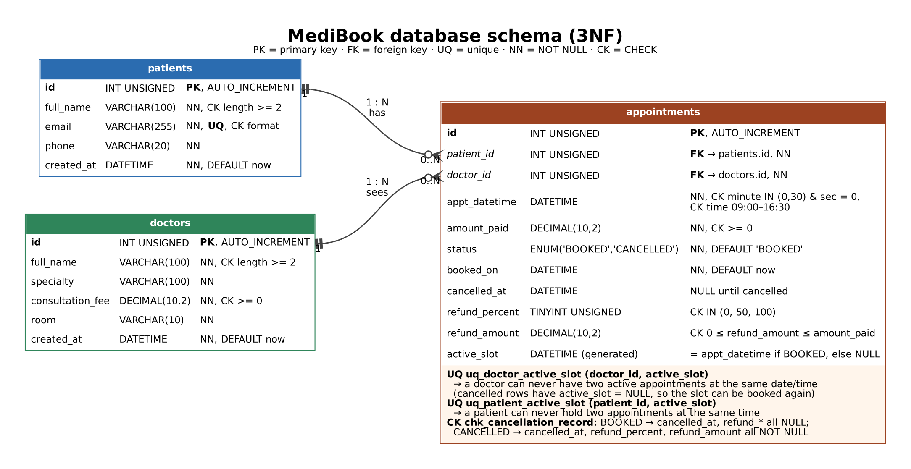

# MediBook: Clinic Appointment Booking Backend
Video walkthrough: (https://youtu.be/682mqK_j-tg)

A backend for booking doctor appointments at a community clinic, built with **Node.js, Express, MySQL (mysql2, parameterized queries only, no ORM) and Redis**.

Doctors see patients in 30-minute slots between 09:00 and 17:00, with at most 12 appointments per day. The API handles patients, doctors, bookings, cancellations with refunds, a Redis waitlist processed by a separate worker, audit logging, reports, and a bilingual course-feedback page.

---

## Contents

1. [Setup](#1-setup)
2. [Project structure](#2-project-structure)
3. [Database design](#3-database-design)
4. [API reference](#4-api-reference)
5. [Design decisions and justifications (Parts C, D, E)](#5-design-decisions-and-justifications)
6. [Testing](#6-testing)

---

## 1. Setup

### Requirements

- Node.js 18 or newer
- MySQL 8.0.16 or newer (CHECK constraints are enforced from 8.0.16)
- Redis 5 or newer. On Windows, use **Memurai** (a Redis-compatible Windows service) or Redis inside **WSL** (`sudo apt install redis-server`).

### Steps

```bash
# 1. Install dependencies
npm install

# 2. Create your environment file and put your MySQL password in it
cp .env.example .env          # Windows Command Prompt: copy .env.example .env

# 3. Create the database and load the sample data
npm run db:setup              # runs database/schema.sql then database/seed.sql
#   (or run the two files yourself in MySQL Workbench / the mysql CLI)

# 4. Start the API (terminal 1)
npm start                     # http://localhost:3000

# 5. Start the background worker (terminal 2): a separate process
npm run worker

# 6. Run the unit tests (no MySQL or Redis needed)
npm test
```

### Environment variables (`.env.example`)

| Variable | Default | Purpose |
|---|---|---|
| `PORT` | `3000` | API port |
| `DB_HOST`, `DB_PORT` | `localhost`, `3306` | MySQL server |
| `DB_USER`, `DB_PASSWORD` | (required) | MySQL credentials |
| `DB_NAME` | `medibook` | Must match the name created by `schema.sql` |
| `REDIS_HOST`, `REDIS_PORT` | `127.0.0.1`, `6379` | Redis server |
| `AUDIT_LOG_PATH` | `logs/audit.log` | Audit log file (folder is created automatically) |

`.env` is git-ignored. Secrets are never committed.

---

## 2. Project structure

```
├── database/
│   ├── schema.sql            DDL: database, 3 tables, all constraints
│   └── seed.sql              sample data (incl. a doctor with 0 appointments and an 11/12 day)
├── docs/schema.dbml          diagram source (paste into dbdiagram.io)
├── schema-diagram.png / .pdf database schema diagram
├── locales/                  en.json, fr.json for the feedback page
├── scripts/setupDatabase.js  runs schema.sql + seed.sql (npm run db:setup)
├── src/
│   ├── app.js                Express app: routes + central error handler
│   ├── server.js             starts the API
│   ├── worker.js             background worker (separate process)
│   ├── config/               env, MySQL pool + transactions, Redis clients, business constants
│   ├── models/               ALL SQL lives here (parameterized with ?)
│   ├── services/             booking/cancellation workflows, Redis queues (shared by API and worker)
│   ├── controllers/          request validation + responses; call models/services, never the DB
│   ├── routes/               URL + HTTP method -> controller
│   ├── middleware/           404 + central error handler
│   ├── utils/                pure functions (slot rules, refund calculator, validators), audit logger
│   └── views/                feedback page HTML
└── tests/                    Jest unit tests
```

Every business value (12-slot cap, 30-minute slots, working hours, refund tiers, busy-day threshold) is defined once in `src/config/constants.js` and passed to SQL as a parameter where needed.

---

## 3. Database design



### From spreadsheet to 3NF

The original spreadsheet repeated patient details (Ama Mensah's email and phone appear twice) and doctor details (Dr. Boateng's specialty, fee and room appear twice). That redundancy causes update anomalies: change a phone number in one row and the data now contradicts itself.

| Spreadsheet column | Is a fact about... | Goes to |
|---|---|---|
| patient_name, patient_email, patient_phone | the patient | `patients` |
| doctor_name, specialty, consultation_fee, room | the doctor | `doctors` |
| appt_datetime, amount_paid, booked_on | this booking | `appointments` |
| appt_ref | the booking's identity | replaced by `appointments.id` |

- **1NF:** every column holds one atomic value, and each table has a primary key.
- **2NF:** every table has a single-column key, so there are no partial dependencies.
- **3NF:** no non-key column depends on another non-key column. Specialty, fee and room depend only on the doctor, so they live in `doctors` and not in `appointments`.

`amount_paid` stays in `appointments` on purpose. It is what was paid **for this booking** (AP-002 paid 120.00 while the fee was 150.00), and it must not change if the doctor's fee changes later. It is a historical fact about the booking, not a copy of the doctor's fee.

### Key constraints

| Rule | Where it is enforced |
|---|---|
| A doctor cannot have two appointments at the same date/time | `UNIQUE (doctor_id, active_slot)` |
| A cancelled slot can be booked again | `active_slot` is a generated column: `appt_datetime` while BOOKED, `NULL` once CANCELLED. UNIQUE ignores NULLs. |
| A patient cannot be in two appointments at once | `UNIQUE (patient_id, active_slot)` |
| 30-minute boundary, working hours | `CHECK` on `appt_datetime` (minute 0/30, seconds 0, 09:00 to 16:30 start) |
| Cancellation record is complete | `CHECK chk_cancellation_record` (status, cancelled_at, refund fields agree) |
| Refund never exceeds payment | `CHECK refund_amount BETWEEN 0 AND amount_paid` |
| History is never orphaned | foreign keys with `ON DELETE RESTRICT` (a patient or doctor with appointments cannot be deleted: 409) |

"Future only" and "12 per day" cannot be CHECK constraints (MySQL forbids `NOW()` in CHECK, and a CHECK cannot count other rows), so they are enforced in the booking transaction. The CHECKs above are the second line of defence behind the application validation.

Money uses `DECIMAL(10,2)` (exact, no floating-point errors). Slots use `DATETIME`.

---

## 4. API reference

Base URL: `http://localhost:3000`. All request and response bodies are JSON. Datetimes are clinic-local in the format `YYYY-MM-DD HH:MM`.

### Patients and doctors (CRUD)

| Method | Path | Success | Errors |
|---|---|---|---|
| GET | `/api/patients` | 200 list | |
| GET | `/api/patients/:id` | 200 | 400 bad id, 404 |
| POST | `/api/patients` | 201 + `Location` | 400 validation, 409 email taken |
| PUT | `/api/patients/:id` | 200 | 400, 404, 409 |
| DELETE | `/api/patients/:id` | 204 | 404, 409 has appointment history |
| GET/POST/PUT/DELETE | `/api/doctors`, `/api/doctors/:id` | same pattern | same pattern |
| GET | `/api/doctors/:id/stats` | 200 statistics | 400, 404 |

Patient body: `{ "fullName": "Ama Mensah", "email": "ama@mail.com", "phone": "0244-111-222" }`
Doctor body: `{ "fullName": "Dr. Boateng", "specialty": "Dermatology", "consultationFee": 150.00, "room": "R-12" }`

### Appointments

| Method | Path | Success | Errors |
|---|---|---|---|
| POST | `/api/appointments` | 201 booked | 400 malformed, 404 patient/doctor, 409 slot taken / day full / patient busy, 422 past / outside hours / off-boundary |
| GET | `/api/appointments/:id` | 200 | 404 |
| DELETE | `/api/appointments/:id` | 200 cancelled + refund amount | 404, 409 already cancelled, 422 already started |

Book: `{ "patientId": 4, "doctorId": 1, "apptDatetime": "2026-12-01 10:30" }`

### Waitlist

| Method | Path | Success | Errors |
|---|---|---|---|
| POST | `/api/waitlist` | 201 + position | 400, 404, 409 already waiting, 422 past date, 503 Redis down |
| GET | `/api/waitlist?doctorId=1&date=2026-12-01` | 200 queue in order | 400 |

Join: `{ "patientId": 5, "doctorId": 1, "date": "2026-12-01", "preferredTime": "12:30" }`

### Reports

| Method | Path | Returns |
|---|---|---|
| GET | `/api/reports/doctors` | every doctor (including those with 0 appointments) with totals and revenue |
| GET | `/api/reports/busy-days` | every (doctor, date) with more than 80% of the 12 daily slots booked |

### Feedback page

`GET /feedback` (English), `GET /feedback?lang=fr` (French). Any other `lang` value falls back to English.

---

## 5. Design decisions and justifications

### Part C: booking

**Status codes.** `400` means the request itself is malformed (missing field, not a date, bad id). `422` means it is well-formed but breaks a business rule (past, outside hours, not on a 30-minute boundary, cancelling a started appointment). `409` means it conflicts with the current state of the data (slot taken, day full, email taken, already cancelled). `404` means an unknown id. Every 409 for a full slot or day includes a `waitlist` object telling the client how to join the waitlist.

**Concurrency: two patients, one slot.** The final guard is the database itself: `UNIQUE (doctor_id, active_slot)`. If two requests arrive at the same instant, MySQL lets exactly one INSERT succeed and rejects the other with a duplicate-key error, which the service turns into `409 SLOT_TAKEN`. An application-only check ("SELECT, then INSERT if free") would have a race window between the two statements. A unique index has none. Tested with 8 simultaneous requests for one slot: 1 × 201, 7 × 409.

**Concurrency: the 12-per-day cap.** A unique index cannot express "at most 12 per day", and two requests for *different* free slots could both count 11 and both insert, giving 13. So each booking runs in a transaction that first runs `SELECT ... FROM doctors WHERE id = ? FOR UPDATE`. That row lock makes bookings for the same doctor run one at a time: the second transaction waits until the first commits, then sees the new count. Bookings for different doctors are not blocked. Tested with 5 simultaneous requests on an 11/12 day: 1 × 201, 4 × 409, and the day ends at exactly 12.

**Price.** `amount_paid` is set by the server from the doctor's current `consultation_fee`. The client never sends a price.

### Part C: cancellation and refunds

**Refund policy** (computed by the server in `src/utils/refund.js`, a pure function):

| Notice before the appointment | Refund |
|---|---|
| more than 48 hours | 100% |
| 24 to 48 hours, **both boundaries included** (exactly 48h and exactly 24h give 50%) | 50% |
| less than 24 hours | 0% |

Reasoning: the brief says "more than 48 hours" for 100%, so exactly 48h is not more than 48 and falls into 50%. "24–48 hours" includes 24, so exactly 24h is 50%, and only less than 24h gives 0%. Amounts are computed in whole cents to avoid floating-point errors.

**Why `DELETE` cancels but keeps the row.** To the client, the booking is removed and the slot is freed, which is what `DELETE` means. Internally it is a soft delete: the row becomes `status = 'CANCELLED'` with `cancelled_at`, `refund_percent` and `refund_amount`, so refund history is never lost. Because `active_slot` becomes NULL, the unique index no longer blocks that slot, and another patient can book it straight away.

**Cancellation and refund succeed or fail together.** The status change and the refund fields are written by a single `UPDATE` on the same row, inside a transaction that first locks the row (`SELECT ... FOR UPDATE`). One statement is atomic, so there can never be a cancellation without its refund record, or the reverse. The lock means two simultaneous cancels cannot both refund (the second gets `409 already cancelled`). `chk_cancellation_record` makes an incomplete cancellation impossible even at database level.

**Statistics and reports** are computed entirely in SQL in the models: `LEFT JOIN` + `GROUP BY` + `SUM`/`COUNT` for revenue and totals (the LEFT JOIN keeps doctors with zero appointments), a recursive CTE that generates the next 7 calendar days so days with 0 appointments still appear, and `HAVING COUNT(*) > cap × 0.8` for busy days. *Revenue collected* = amount paid minus any refund, so a cancelled booking still counts the part that was not refunded.

### Part D: audit log

`src/utils/auditLogger.js` appends one JSON object per line to `logs/audit.log` with `fs/promises` (`mkdir` with `recursive: true`, then `appendFile`), so there are no `*Sync` calls anywhere in the request path. The `logs/` folder is created on the first write. Every error inside the logger is caught and printed to the console and never re-thrown, so a logging failure (disk full, permissions) can never fail a booking or cancellation that has already been committed. The log is written only **after** the transaction commits, so it never records something that was rolled back.

Events: `APPOINTMENT_BOOKED`, `APPOINTMENT_CANCELLED`, `CONFIRMATION_SENT`, `WAITLIST_PROMOTED`, `WAITLIST_PROMOTION_FAILED`, `WAITLIST_ENTRY_DROPPED`, `JOB_FAILED`, `JOB_ENQUEUE_FAILED`.

### Part E: queues and Redis

**Two kinds of queue**, both plain Redis lists used FIFO (producers `LPUSH`, the consumer takes from the right):

- `medibook:jobs`: background jobs. Each confirmed appointment enqueues a `confirmation` job, and each cancellation enqueues a `slot-freed` job.
- `medibook:waitlist:{doctorId}:{date}`: one waitlist per doctor per day.

**The worker is a separate process** (`npm run worker`, `src/worker.js`), not part of the web server. It blocks on `BRPOPLPUSH` waiting for jobs, so it uses no CPU while idle.

**Waitlist granularity.** A waitlist is per doctor per day. When any slot that day is freed, the first person in line is booked into it. Their preferred time is stored for information.

**What if the promoted booking fails?** This is handled with the *reliable queue* pattern:

1. The worker never pops a patient off the waitlist outright. It uses `RPOPLPUSH` to atomically **move** them into `...:processing`. At every moment the patient is in exactly one of the two lists, never in neither.
2. It then books them through the **same** `bookingService.bookAppointment` the API uses, so every rule (cap, unique slot, future-only) still applies.
3. **Success:** the patient is removed from `processing`. The booking enqueues its own confirmation job, and the promotion is audited.
4. **Failure for a business reason** (the slot was taken by someone else first, or the patient already has an appointment at that time): the patient is moved back to the **front** of the waitlist in one `MULTI` transaction, and `WAITLIST_PROMOTION_FAILED` is audited with `patientKeptOnWaitlist: true`.
5. **Temporary failure** (database down): the patient is moved back to the front **and** the job is retried up to 3 times, 2 seconds apart. Tested by stopping MySQL: the retry succeeded once MySQL was back, and the patient was booked.
6. **Patient deleted while waiting:** there is nobody to book, so the entry is dropped and audited.
7. **Worker crash mid-promotion:** on startup the worker moves everything left in `processing` lists back to the front of their queues.

Jobs that fail 3 times go to `medibook:jobs:failed` (a dead-letter list) and are audited, never silently lost.

**If Redis is down in the API.** The booking or cancellation still succeeds, because the database is the source of truth, and the failed enqueue is logged as `JOB_ENQUEUE_FAILED`. The API's Redis client is configured to fail fast instead of hanging requests. Known limitation: with exactly 3 tables allowed there is no outbox table, so a slot freed while Redis is down does not trigger a promotion. The slot is still free and bookable.

**Notifications.** The worker processes each `confirmation` job by writing the SMS and email text to the audit log as `CONFIRMATION_SENT`. Nothing is really sent.

---

## 6. Testing

```bash
npm test
```

28 Jest unit tests in `tests/`. None of them need MySQL or Redis, because the logic under test is extracted into pure functions:

- `refund.test.js`: all three tiers, **exactly 48h and exactly 24h**, one minute either side of each boundary, cent rounding. Uses fixed dates only.
- `slotRules.test.js`: 09:00 and 16:30 accepted. Rejected: 17:00 exactly, 08:30, 09:15, non-zero seconds, the past, "now" itself, malformed values (`2026-02-30`, `25:00`, date-only, a number), and a missing value.
- `validators.test.js`: patient and doctor validation, id parsing.
- `feedbackLocale.test.js`: language selection and fallback to English.
